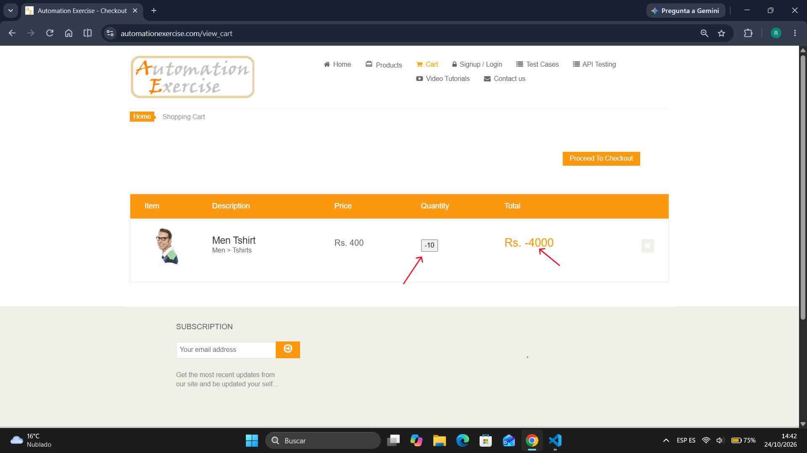
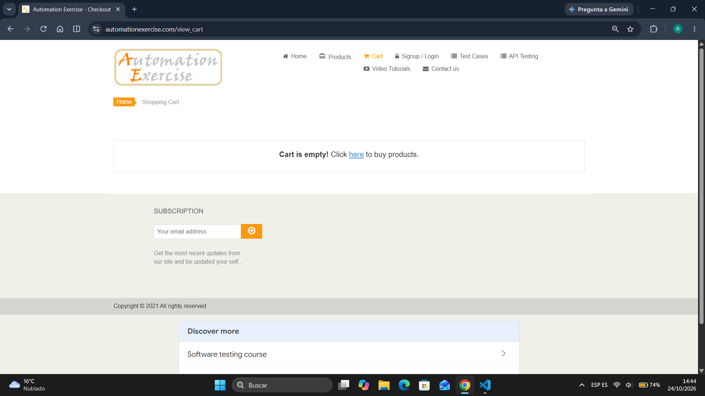
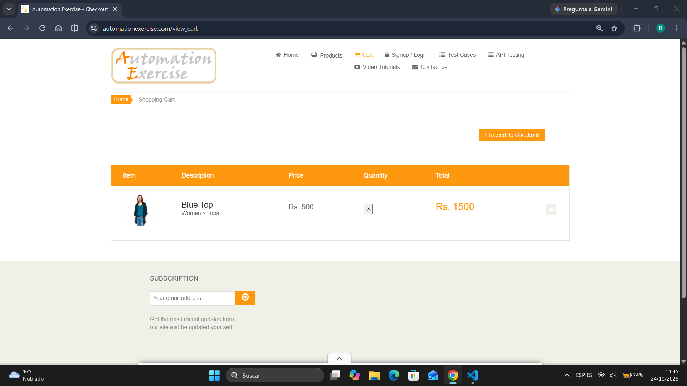

# Reporte de defectos (bug tracking)

A continuacion se detallan las incidencias encontradas durante la ejecucion del ciclo de pruebas

---

## [BUG-01] [Modulo 3] - [Se permite agregar numeros negativos de un producto al carrito]

* **Caso de prueba asociado:** TC-09
* **Severidad:** Critica / Alta
* **Prioridad:** Alta
* **Estado:** Abierto (Open)
* **Entorno:** Chrome / Windows 11 home

### Descripcion
Al navegar en el producto, se puede modificar las cantidades a agregar al carrito, permitiendo asi numeros negativos, que los mismos alteran el precio del articulo.

### Pasos para reproducir
1. Ingresar en `https://automationexercise.com/products` y dar clic en "View Product" de algun articulo
2. En el input de "Quantity" ingresar un numero negativo, por ej: -5
3. Hacer clic en el boton "Add to cart"

### Resultado esperado
El input no deberia permitir el ingreso de numeros negativos, y mostrar un mensaje de alerta.

### Resultado actual
Se muestra en pantalla un pop up con el mensaje exitoso de "Added!"

### Informacion tecnica / evidencia
* **Comportamiento en DevTools (opcional):** [Ej: en la pestaña console no arroja errores / en network el request devuelve 200 ok a pesar del dato invalido].
* **Captura de pantalla:**

---

## [BUG-02] [Módulo 3] - [Item eliminado del carrito vuelve a aparecer luego de recargar pagina]

* **Caso de prueba asociado:** TC-10
* **Severidad:** Alta
* **Prioridad:** Media
* **Estado:** Abierto (Open)

### Descripción
Al agregar un producto al carrito y navegar hacia el mismo, luego de dar clic en "X" se elimina el articulo, pero al hacer refresh vuelve a aparecer-

### Pasos para reproducir
1. Estar en `https://automationexercise.com/products` y hacer clic en el boton "Add to cart" de algun articulo
2. Ir a `/view_cart` y dar clic en el boton "X" para eliminar el articulo

### Resultado Esperado
Al dar clic en "X" deberia eliminarse el articulo exitosamente y al recargar aun deberia aparecer "Cart is empty"

### Resultado Actual
Se recarga la pagina y vuelve a aparecer el articulo anteriormente eliminado

### Evidencia

## [BUG-03] [Modulo 2 - API] - [Endpoint devuelve HTTP 200 OK en lugar de 400 Bad Request al omitir parametro obligatorio]

* **Caso de prueba asociado:** API-03
* **Severidad:** Alta/Media
* **Prioridad:** Media
* **Estado:** Abierto (Open)
* **Herramienta utilizada:** Postman v12.33.4

### Descripcion
Al realizar una petición con el método POST al endpoint de búsqueda de productos omitiendo el parámetro obligatorio search_product, el backend detecta correctamente la falta del dato dentro del cuerpo de la respuesta (JSON con responseCode: 400). Sin embargo, la cabecera de la respuesta HTTP devuelve erróneamente un estado de éxito 200 OK, generando un falso positivo.

### Pasos para reproducir
1. Abrir Postman y seleccionar el metodo POST 
2. Ingresar la URL del endpoint: "https://automationexercise.com/api/searchProduct"
3. Dejar el contenido de body vacio (sin parametros)
4. Hacer clic en el boton Send

### Resultado esperado
El servidor deberia rechazar la peticion directamente desde la capa de rep con un estado de cabecera HTTP 400 Bad Request

### Resultado actual
El encabezado de la respuesta HTTP devuelve un estado 200 OK

### Evidencia
[Evidencia BUG-03](../evidencias/bug_03_api.png)
[Evidencia BUG-03](../evidencias/bug_03_api_json.png)

